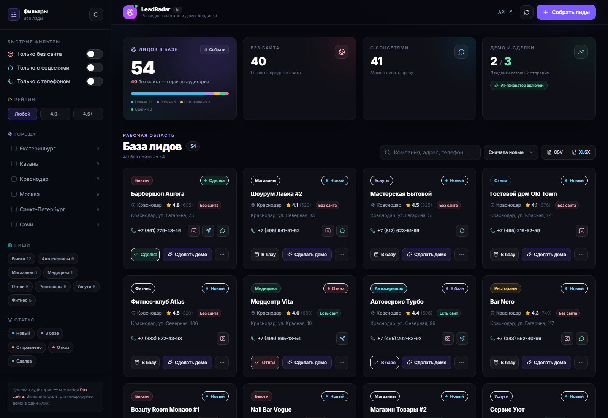
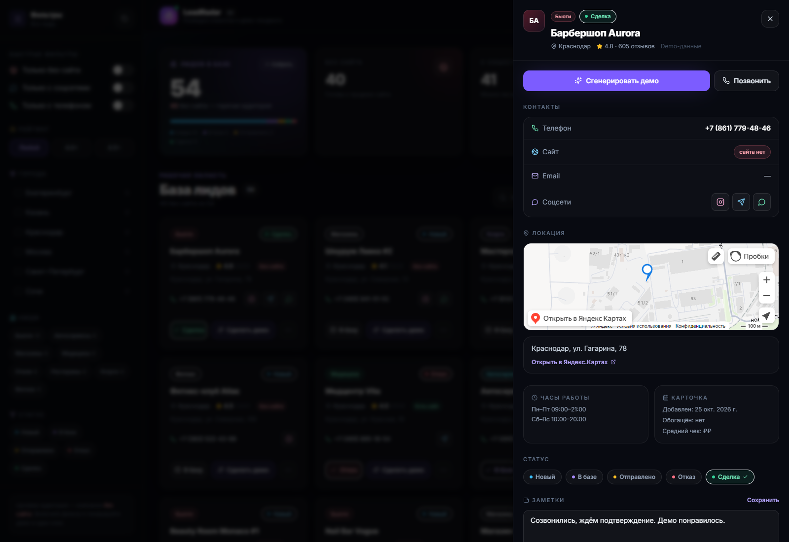
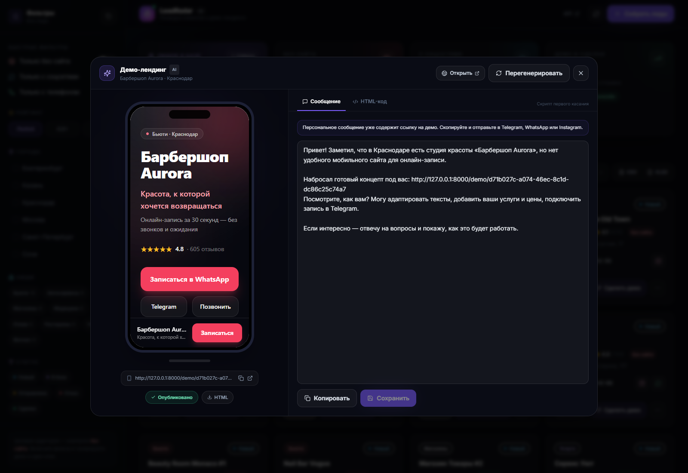
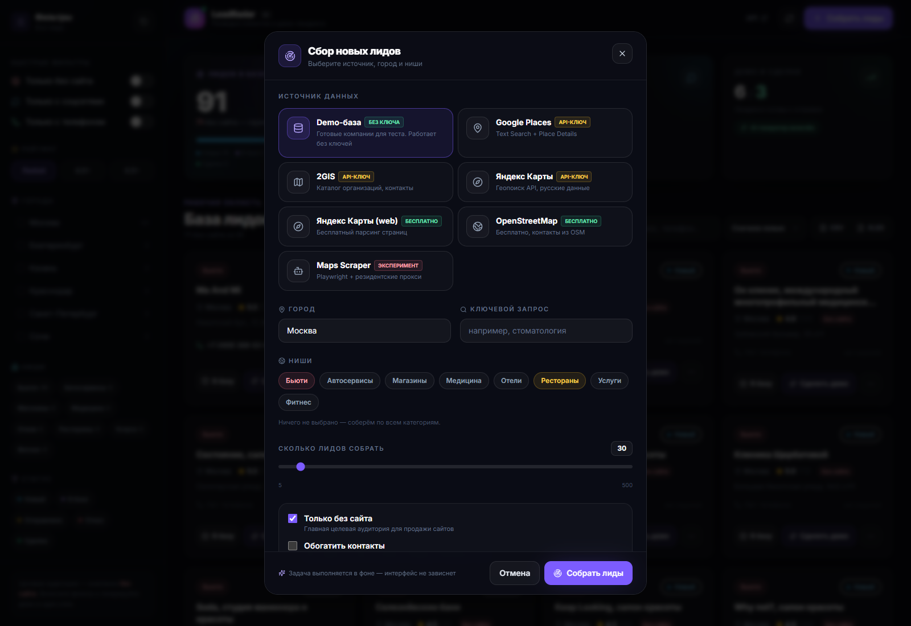
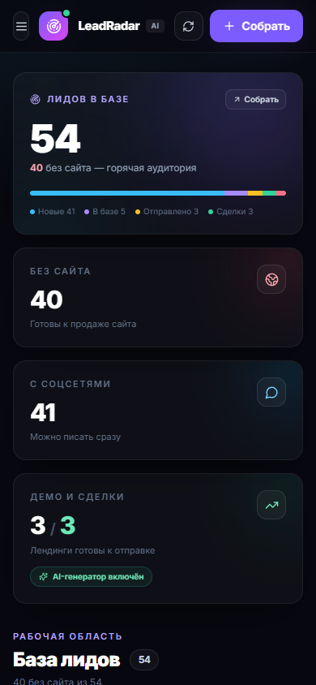

# LeadRadar — AI-разведка клиентов

Полный цикл продаж сайтов и digital-услуг малому бизнесу: **сбор лидов из карт → обогащение контактов → база со статусами → AI-демо-лендинг → персональное сообщение для аутрича**.



## Что реализовано

| Этап | Возможности |
| --- | --- |
| **1. Сбор данных** | Google Places API (New), 2GIS Catalog API, Яндекс Геопоиск API, бесплатный OpenStreetMap (Overpass + Nominatim), бесплатный парсер Яндекс.Карт через Playwright, экспериментальный Google Maps-скрапер, demo-источник без ключей. Фильтры по городу, нишам, «только без сайта», радиусу/координатам. |
| **2. Обогащение** | Сканирование сайта и страниц `/contact`, поиск Instagram / Telegram / WhatsApp / e-mail / телефона, SSL-fallback, конкурентные запросы, прокси. |
| **3. База и бэкенд** | PostgreSQL или SQLite (dev), SQLAlchemy 2 async, статусы `Новый → В базе → Отправлено → Отказ → Сделка`, дедупликация, фоновые задачи (Celery + Redis или in-process), экспорт CSV/XLSX. |
| **4. UI/UX** | Тёмный дашборд: статистика, сайдбар фильтров, сетка карточек, бейджи соцсетей, шторка с картой и заметками, мобильная версия. |
| **5. AI** | Генерация мобильного лендинга (OpenAI / Anthropic / встроенный шаблон), превью в макете смартфона, редактирование HTML и текста, публикация по ссылке `/demo/{id}`, персональный cold outreach. |

### Экраны

| Детальная карточка | AI-демо и сообщение |
| --- | --- |
|  |  |

| Сбор лидов | Мобильная версия |
| --- | --- |
|  |  |

## Быстрый старт (Windows)

Нужны **Python 3.11+** и **Node.js 20+**. Docker не обязателен.

```powershell
# из папки проекта
.\run-dev.ps1
```

Скрипт создаст venv, поставит зависимости, создаст `backend/.env` и запустит два окна:

- UI — http://localhost:3000
- API + Swagger — http://127.0.0.1:8000/docs

При первом запуске база автоматически наполняется **54 демо-компаниями** (Москва, СПб, Казань, Екатеринбург, Сочи, Краснодар), поэтому интерфейс сразу показывает реальные сценарии. Источник **Demo-база** работает без ключей.

### Запуск вручную

```powershell
cd backend
python -m venv .venv
.\.venv\Scripts\Activate.ps1
pip install -r requirements.txt
Copy-Item .env.example .env
uvicorn app.main:app --reload --port 8000
```

```powershell
cd frontend
npm install
npm run dev
```

## Как пользоваться

1. Нажмите **«Собрать лиды»** → выберите источник, город, ниши и лимит.
2. Включите **«Только без сайта»** — это целевая аудитория для продажи сайтов.
3. Откройте карточку: проверьте телефон, соцсети, часы работы и точку на карте.
4. Нажмите **«Сгенерировать демо»** — AI соберёт мобильный лендинг и текст первого сообщения.
5. Отредактируйте текст/HTML при необходимости, скопируйте сообщение и ссылку на демо, отправьте в Telegram или WhatsApp.
6. Ведите лид по статусам и выгружайте базу в CSV/XLSX.

## Архитектура

```
┌──────────────┐      REST/JSON      ┌───────────────────────────────┐
│ Next.js 15   │ ──────────────────► │ FastAPI (async)               │
│ React 19     │                     │  ├─ API: leads/parse/demos    │
│ TailwindCSS  │ ◄────────────────── │  ├─ Providers: Google/2GIS/   │
│ lucide-react │    демо-HTML/iframe │  │   Yandex/OSM/Scraper/Demo   │
└──────────────┘                     │  ├─ Enrichment (httpx+regex)  │
                                     │  ├─ AI (OpenAI/Anthropic/     │
┌──────────────┐                     │  │   template)                │
│ PostgreSQL   │ ◄────────────────── │  └─ Jobs (Celery/Redis или    │
│ Redis/Celery │                     │      asyncio background)      │
└──────────────┘                     └───────────────────────────────┘
```

- **Дедупликация** — по `source + source_id`, при отсутствии ID — по названию и телефону.
- **Фоновые задачи** — по умолчанию `asyncio`, для production включите `USE_CELERY=true` и запустите воркер.
- **Публичные демо** — `GET /demo/{id}` отдаёт готовый HTML с `noindex`; отключить публикацию можно в модалке.
- **Безопасность** — сгенерированный LLM HTML санитизируется (удаляются сторонние скрипты и inline-обработчики), iframe работает в sandbox.

### Структура

```
парсер/
├─ backend/
│  ├─ app/
│  │  ├─ api/           # leads, parse, meta, demos, export
│  │  ├─ providers/     # demo, google, twogis, yandex, yandex_web, osm, scraper
│  │  ├─ services/      # jobs, enrichment, landing, llm, demos
│  │  ├─ tasks/         # Celery app + worker
│  │  ├─ config.py      # настройки из .env
│  │  ├─ db.py models.py schemas.py seed.py main.py
│  ├─ tests/            # pytest: API, enrichment, landing, providers
│  ├─ requirements.txt requirements-dev.txt requirements-scraper.txt
│  └─ Dockerfile .env.example
├─ frontend/
│  ├─ app/              # layout, страница дашборда, иконка
│  ├─ components/       # Sidebar, LeadCard, Drawer, DemoModal, ...
│  ├─ lib/              # API-клиент, типы, утилиты
│  └─ Dockerfile .env.example
├─ docs/screenshots/
├─ docker-compose.yml
├─ run-dev.ps1 run-backend.ps1 run-frontend.ps1
└─ README.md
```

## Настройка источников

Все ключи — в `backend/.env` (см. `.env.example`). Источники **Demo** и **OpenStreetMap** работают вообще без ключей.

### Demo (по умолчанию)

Ключи не нужны. Детерминированная генерация компаний с телефонами, рейтингами, соцсетями и сайтами (часть — без сайта). Идеально для демонстрации и тестов.

### OpenStreetMap / Overpass (бесплатно)

Ключ не нужен — выберите источник **OpenStreetMap** в UI. Данные берутся из тегов OSM: название, телефон, сайт, соцсети, email, адрес, часы работы. В выдачу попадают только объекты, у которых есть хотя бы один контакт.

- Покрытие зависит от города и активности участников OSM.
- Для городов из demo-набора используется быстрый поиск по bbox, для остальных — area-запрос.
- Если Overpass недоступен/лимитирован, автоматически включается fallback на Nominatim (меньше результатов, но стабильнее). Кэш — 10 минут.

### Google Places API (New)

1. В Google Cloud включите **Places API (New)** и биллинг.
2. Создайте API-ключ.
3. Укажите `GOOGLE_PLACES_API_KEY=...`.

Используется `places:searchText` с FieldMask, пагинация и `locationBias` по координатам/радиусу.

> **Российский биллинг Google Maps Platform не поддерживается.** В списке стран при активации trial РФ отсутствует. Подмена страны нарушает условия Google и всё равно упрётся в оплату. Для РФ-рынка используйте 2GIS, OSM или скрапер. Если есть легальное зарубежное юрлицо и биллинг — ключ можно оформить там.

### 2GIS

1. Получите ключ в [dev.2gis.ru](https://dev.2gis.ru).
2. Укажите `TWOGIS_API_KEY=...`.

Демо-ключ 2GIS работает ограниченное время и отдаёт урезанный набор полей: названия, адреса, рейтинги, но часто **без телефонов и сайтов**. Для полноценных контактов нужен платный тариф Catalog API.

### Яндекс Карты (Геопоиск API)

1. Откройте кабинет [developer.tech.yandex.ru/services](https://developer.tech.yandex.ru/services).
2. Подключите **API Геопоиска** (входит в Яндекс Карты API) и получите ключ.
3. Укажите `YANDEX_MAPS_API_KEY=...` в `backend/.env`.

Провайдер ходит в `https://search-maps.yandex.ru/v1/`, ищет организации (`type=biz`) по нишам и городу/bbox, забирает название, адрес, телефоны, сайт, часы работы, категории и координаты. Тариф платный, оплата российская; лимиты зависят от подключённого пакета.

### Яндекс Карты (web, бесплатно)

Ключ не нужен. Источник **«Яндекс Карты (web)»** открывает публичный поиск Яндекс.Карт в headless-браузере и собирает данные с карточек организаций: телефон, сайт, Telegram/WhatsApp, адрес, рейтинг, число отзывов, часы работы.

- Нужен установленный Chrome или `playwright install chromium` (пакет ставится через `requirements-scraper.txt`).
- Бесплатно, но это парсинг публичных страниц: возможны капча и изменения вёрстки, а массовый сбор нарушает ToS Яндекса. Для объёма используйте прокси (`PROXY_URL`) и умеренный темп.
- За один запрос обрабатывается до лимита из UI; на 20–50 карточек уходит несколько минут — задача выполняется в фоне.

### Скрапер (экспериментальный)

```powershell
cd backend
pip install -r requirements-scraper.txt
python -m playwright install chromium
```

Задайте `PROXY_URL` (резидентский прокси) и выберите источник **Maps Scraper** в UI. Это browser automation: селекторы Google Maps нестабильны, а объём зависит от прокси и лимитов. Для стабильного продакшена используйте официальные API.

## AI-генерация

| Провайдер | Настройки | Поведение |
| --- | --- | --- |
| `mock` (по умолчанию) | `LLM_PROVIDER=mock` | Мгновенный встроенный шаблон: 8 нишевых профилей, услуги/цены, отзывы, CTA, sticky-панель. Работает без ключей и интернета. |
| OpenAI | `LLM_PROVIDER=openai`, `OPENAI_API_KEY`, `OPENAI_MODEL` | Полный HTML генерирует LLM, затем санитайзер. |
| Anthropic | `LLM_PROVIDER=anthropic`, `ANTHROPIC_API_KEY`, `ANTHROPIC_MODEL` | То же через Messages API (по умолчанию Claude 3.5 Sonnet). |

Если LLM недоступна или вернула невалидный ответ — автоматически используется шаблон, пользователь не видит ошибки.

## Docker

```powershell
# ключи можно передать через переменные окружения
$env:GOOGLE_PLACES_API_KEY = "..."
$env:LLM_PROVIDER = "openai"
$env:OPENAI_API_KEY = "..."
docker compose up --build
```

Поднимаются: PostgreSQL, Redis, backend, Celery worker и frontend. UI — http://localhost:3000. Для production задайте `PUBLIC_BASE_URL` и `CORS_ORIGINS` под свои домены, а `NEXT_PUBLIC_API_URL` — на публичный адрес API.

## API

Полная схема — Swagger: `http://127.0.0.1:8000/docs`.

| Метод | Endpoint | Назначение |
| --- | --- | --- |
| `GET` | `/api/leads` | Список с фильтрами, поиском, сортировкой, пагинацией |
| `GET` | `/api/leads/{id}` | Карточка лида |
| `PATCH` | `/api/leads/{id}` | Статус, заметки, телефон, сайт |
| `POST` | `/api/leads/bulk-status` | Массовая смена статуса |
| `POST` | `/api/leads/{id}/enrich` | Обогатить контакты |
| `POST` | `/api/leads/{id}/demo` | Сгенерировать демо |
| `POST` | `/api/leads/{id}/message` | Сгенерировать аутрич-сообщение |
| `GET` | `/api/leads/{id}/demo` | Последнее демо лида |
| `GET/PATCH` | `/api/demos/{id}` | Получить/изменить HTML, текст, публикацию |
| `GET` | `/api/demos/{id}/raw` | Чистый HTML для iframe |
| `POST` | `/api/parse` | Запустить сбор (202 Accepted) |
| `GET` | `/api/jobs/{id}` | Статус задачи сбора |
| `GET` | `/api/meta` | Фасеты городов, ниш, статусов, счётчики |
| `GET` | `/api/stats` | Дашборд-статистика |
| `GET` | `/api/export?fmt=csv\|xlsx` | Экспорт с учётом фильтров |
| `GET` | `/demo/{id}` | Публичная демо-страница (noindex) |
| `GET` | `/health` | Healthcheck |

Фильтры списка: `search`, `city`, `category`, `status`, `source`, `only_no_website`, `only_social`, `only_phone`, `min_rating`, `min_reviews`, `sort`, `page`, `page_size`.

## Тесты и сборка

```powershell
cd backend
pip install -r requirements-dev.txt
pytest
```

26 тестов: API-сценарии (лид → статус → демо → публикация → экспорт → фоновая задача), извлечение контактов, санитайзер HTML, demo-, OSM-, Nominatim-, Yandex API- и Yandex web-провайдеры.

```powershell
cd frontend
npm run build
```

## Ограничения MVP

- Нет авторизации и мультитенантности — перед публичным запуском добавьте аутентификацию и ограничения по пользователям.
- Схема БД создаётся через `create_all`; для эволюции схемы подключите Alembic.
- Google недоступен для РФ-биллинга; 2GIS и Яндекс API требуют ключей/оплаты; OSM бесплатен, но покрытие контактов неравномерное; веб-парсер Яндекс.Карт бесплатен, но может ловить капчу и нарушает ToS; скрапер зависит от прокси и может ломаться при изменении вёрстки карт.
- Отправка сообщений автоматизирована только на уровне генерации текста — интеграции с Telegram/WhatsApp API и трекинг ответов в roadmap.
- Соблюдайте условия использования источников и законодательство о персональных данных (152-ФЗ). Для продакшена предпочтительны официальные API.

## Roadmap

- Авторизация, workspace и роли.
- Alembic-миграции и партиционирование лидов.
- Очередь обогащения с ретраями и прокси-пулом.
- Интеграция Telegram-бота для отправки и трекинга ответов.
- A/B-варианты демо и аналитика конверсии.
- Вебхуки/CRM-синхронизация (amoCRM, Bitrix24).
- Биллинг и лимиты на генерации.
